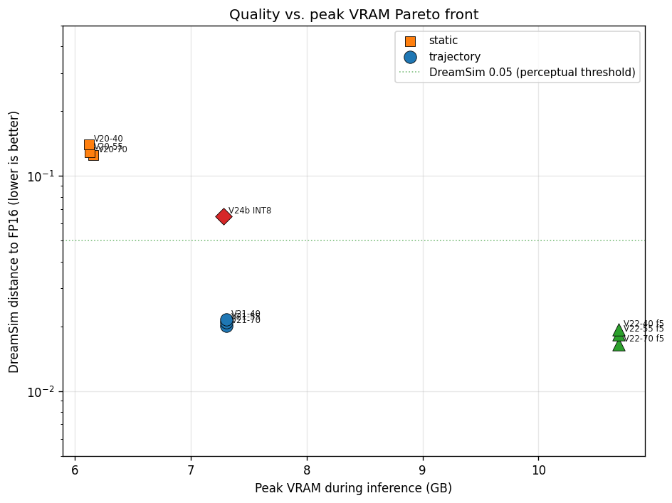
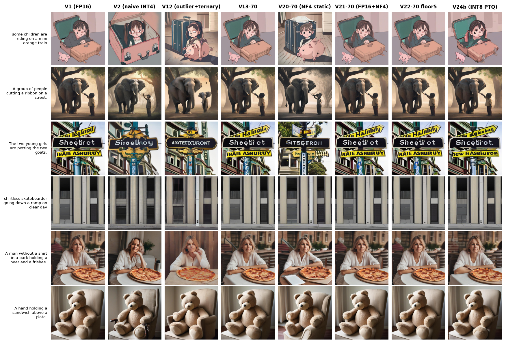
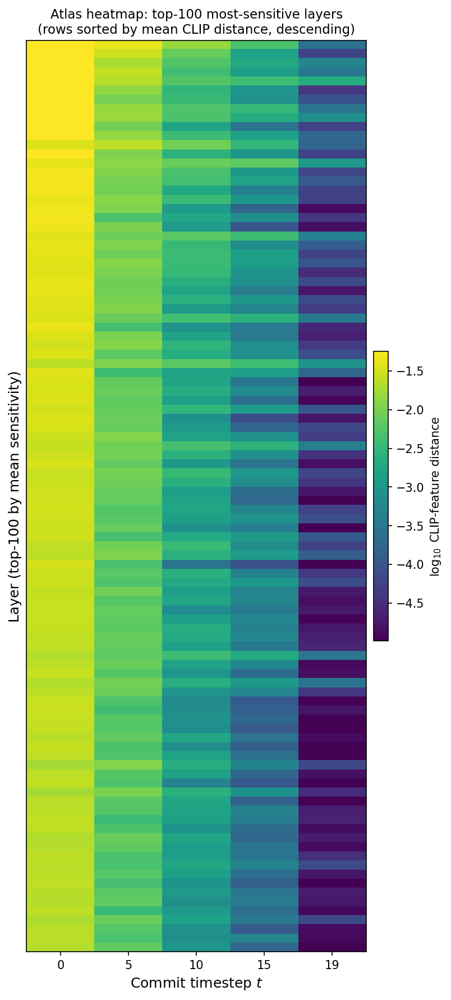
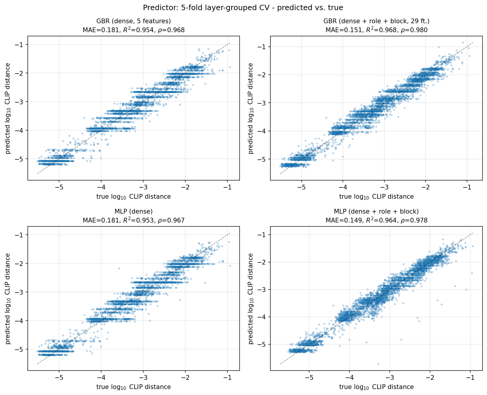
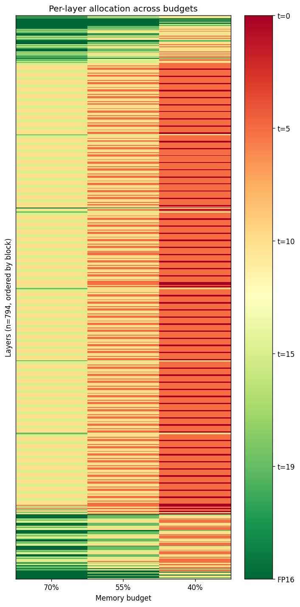
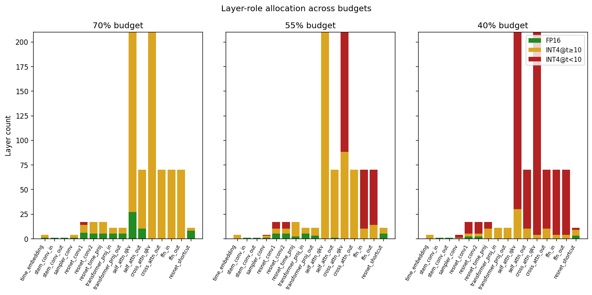

# Trajectory-Aware Mixed-Precision Quantization of Stable Diffusion XL

**From sensitivity atlas to realised memory savings.**

This repository contains the framework, runtime architectures, and experimental
artefacts behind an M.Tech thesis (IIT Gandhinagar, May 2026) on quantizing SDXL's
2.6B-parameter U-Net without any retraining, while actually reducing *peak inference
VRAM* — not just stored weight size. The full thesis PDF is at
[`docs/thesis/24210059_M_Tech_Thesis.pdf`](docs/thesis/24210059_M_Tech_Thesis.pdf);
this README is a condensed version of it.

> **Hardware note:** nothing here needs a data-center GPU. Peak VRAM across every
> variant in this repo stays under 15 GB (see the [table below](#results-at-a-glance)),
> so the entire pipeline — atlas measurement aside — runs comfortably on a free/Colab-Pro
> T4, L4, or A100 instance, or any local 16 GB card.

---

## The problem

SDXL's U-Net alone is ~5 GB in FP16. Naively quantizing it to INT4 gets you a
~72% smaller model, and standard metrics (CLIP score, FID) will tell you it's fine.
It isn't: **the model produces a visibly different image** for the same prompt and
seed. CLIP and FID are insensitive to this because they measure prompt-alignment and
distributional realism, not *identity* — whether the quantized model produced *the
same picture* the FP16 model would have. [DreamSim](https://dreamsim-nights.github.io/)
(a learned perceptual-similarity metric) captures it: naive INT4 sits at DreamSim
0.20 against FP16, and 0.05 is roughly the threshold below which humans can't tell
two images apart.

Twelve hand-engineered variants (ternary mid-blocks, SmoothQuant, GPTQ, outlier
preservation, timestep-aware LoRA — see `archive/v1_to_v12`) were tried before this
project's core idea, and all twelve plateaued in the same place: CLIP within 0.0013
of each other, DreamSim never below 0.18. Every one of them was making a **static,
per-layer** choice — a weight matrix is either FP16 or INT4 for the model's entire
lifetime.

## The idea: precision is also a function of *time*

SDXL denoises a latent over `T=20` scheduler steps. A weight matrix's role is not
the same at step 0 (pure noise) as it is at step 19 (almost the final image) — so
"is this layer safe to quantize?" is the wrong question. The right one is
**"is this layer safe to quantize *starting at step t*?"**

That single reframing is the whole contribution. It turns each layer's decision from
a binary (FP16 / INT4) into a choice over *when along the trajectory* to commit to
INT4 — and that extra axis, it turns out, is worth far more than any per-layer
quantization trick tried before it.

---

## Results at a glance

Peak VRAM is full end-to-end 768×768 / 20-step inference, measured on the deployment
hardware. DreamSim is against the FP16 baseline (0 = identical, ≤0.05 = perceptually
indistinguishable to humans).

| Variant | What it is | Peak VRAM | DreamSim ↓ | Notes |
|---|---|---:|---:|---|
| **V1** | FP16 baseline | 9.50 GB | 0.000 | reference |
| V2 | Naive per-channel INT4 | — | 0.202 | "successful" by CLIP/FID, visibly wrong image |
| V12 | Best hand-engineered variant (outlier+ternary) | — | 0.188 | 3 weeks of engineering, still fails |
| V13 | Trajectory allocation, reference runtime | 14.62 GB | 0.026 | proves the idea; VRAM *worse* than FP16 (holds both copies) |
| V20 | Static NF4, no trajectory | **6.16 GB** | 0.125 | lowest VRAM, but lossy |
| **V21** | Two-pass FP16→NF4 with trajectory split | **7.30 GB** | **0.020** | ✅ recommended for ≤8 GB targets |
| **V22-floor5** | Per-layer hot-swap, trajectory-scheduled | 10.69 GB | **0.0165** | ✅ best quality, for 12–16 GB cards |
| V24b | Static INT8 PTQ (bitsandbytes baseline) | 7.28 GB | 0.065 | same VRAM as V21, **3.2× worse** |

The cleanest single result in the repo: **V20 → V21** changes nothing about the
underlying NF4 weights — it only runs the first 10 of 20 steps in FP16 before
swapping to NF4. That costs 1.14 GB of VRAM and buys a **6.2× drop in DreamSim**
(0.125 → 0.020), while CLIP and FID barely move (Δ ≤ 0.0001, well inside metric
noise). Same weights, different point in the trajectory, categorically different
output.

<p align="center">
  
  <br><sub>Peak VRAM vs. DreamSim distance to FP16. Trajectory-aware variants (V21, V22) sit
  below the 0.05 perceptual-indistinguishability line; static NF4 (V20) and static INT8 (V24b)
  sit above it at similar or higher VRAM.</sub>
</p>

### Qualitative comparison

<p align="center">
  
  <br><sub>Same prompt + seed across variants. V2 and V12 (naive/hand-tuned INT4, columns 2–3)
  visibly diverge from V1 (FP16, column 1) — different faces, different poses, garbled text.
  V13, V21, and V22-floor5 (trajectory-aware, columns 4/6/7) are essentially indistinguishable
  from V1. V20 (static NF4, column 5) drifts; V24b (static INT8, column 8) drifts less but still
  visibly.</sub>
</p>

---

## How it works

The framework has three algorithmic pieces, followed by a family of runtimes that turn
the allocation into an actual VRAM reduction.

### 1. Sensitivity atlas

For every one of SDXL's 794 quantizable Linear/Conv2d layers, and each of 5 candidate
commit timesteps `t ∈ {0, 5, 10, 15, 19}`, measure: *if this layer is quantized to INT4
starting at step t and left FP16 before that, how far (in CLIP-feature space) does the
final image drift from the FP16 baseline?* That's 794 × 5 = **3,970 measurements**,
each averaged over 8 prompts. A prefix-skip trick (reuse the FP16 trajectory's cached
latents as the resume point) keeps this to ~16 GPU-hours instead of a combinatorial
sweep.

<p align="center">
  
  <br><sub>Top-100 most sensitive layers × 5 commit steps. Sensitivity spans >4 orders of
  magnitude and decreases roughly monotonically with commit step — but the decay rate varies
  wildly per layer (some layers are 750× more forgiving at t=19 than t=0; others only 5×).</sub>
</p>

### 2. Structural-feature predictor

Re-measuring the atlas for a new model or a finer timestep grid isn't cheap, so a
gradient-boosted regressor is trained to predict a cell's sensitivity from **layer
architecture alone** — type, parameter count, role (`cross_attn_qkv`, `ffn_out`, ...),
block depth, and normalized timestep. Critically, no per-layer identity feature is
used, and evaluation is 5-fold cross-validation *grouped by layer name*, so the score
reflects generalization to layers the model has never seen.

Result: **Spearman ρ = 0.980** on held-out layers. Quantization sensitivity in SDXL is,
to a very good approximation, a function of *what a layer is*, not *which specific
layer it is* — which is what makes the whole approach portable to unseen architectures
in principle.

<p align="center">
  
</p>

### 3. ILP allocator

Given the predictor's estimate for every (layer, commit-time) cell, an integer linear
program picks one choice per layer — FP16, or INT4 at one of the 5 commit times — to
minimize total predicted sensitivity subject to a memory budget (solved with CBC via
PuLP, <2 minutes per budget). Five budgets are used: 95%, 85%, 70%, 55%, 40% of FP16.

<p align="center">
  
  
  <br><sub>Left: per-layer allocation at 70/55/40% budgets (green=FP16, red=INT4@t=0). Right:
  same data by layer role — cross-attention and FFN layers get quantized first and hardest;
  time-embedding and stem layers stay FP16 throughout.</sub>
</p>

At loose budgets the allocator only touches the tail of the trajectory (t=15/19). As
the budget tightens, more layers go FP16→INT4 *and* the commit point creeps earlier,
until at 40% the trajectory dimension is essentially exhausted and everything
collapses toward static INT4.

### 4. From allocation to a runtime that actually saves VRAM

This is the part naive implementations skip. The reference implementation (V13) proves
the allocation *works* — DreamSim 0.026 at a nominal 70% memory budget — but it keeps
both the FP16 and INT4 copy of every layer resident on GPU, so its peak VRAM (14.6 GB)
is *higher* than the FP16 baseline. A theoretical compression ratio is not a deployment
win until the runtime is engineered to realise it. Seven runtime variants (V19–V26)
explore that engineering space:

| Variant | Mechanism |
|---|---|
| V19 | V13 + outlier-preserved INT4 (best quality, same VRAM problem as V13) |
| V20 | Whole U-Net loaded as static NF4 via `bitsandbytes` — VRAM floor, no trajectory |
| **V21** | Two separate U-Nets (FP16, NF4); denoise the first half of steps in FP16, hand off the latent, finish in NF4 |
| **V22** | Per-layer hot-swap every scheduler step, following each layer's individual commit time exactly, with a `floor=5` safety clamp to stop early layers collapsing quality at tight budgets |
| V24b | Static INT8 PTQ (`bitsandbytes Linear8bitLt`) — the static-quantization baseline this framework is compared against |
| V25 | Abandoned: INT8+NF4 two-pass with a CPU↔GPU swap between phases — transient co-residency actually *increased* peak VRAM |
| V26 | In-place INT8→NF4 module swap on a single U-Net — lowest peak VRAM of any variant (6.1 GB single-image), but bounded by a `bitsandbytes` `Params4bit` storage bug after ~50–200 swaps |

## What the ablations rule out

- **Random allocation (V16)** collapses quality (DreamSim 0.23–0.33) — the
  predictor-driven allocation is doing real work, not just spreading the budget around.
- **V13's layer selection with the trajectory removed (V17)**, and **the same
  selection with a better per-layer quantizer but still no trajectory (V18)**, both
  regress to V12-class quality (DreamSim ~0.22–0.27). The trajectory dimension isn't
  a nice-to-have on top of good layer selection — it *is* where the value comes from.
- **Swapping naive INT4 for calibration-aware GPTQ (V15)** is a null result (Δ
  DreamSim inside the noise floor), even after filtering to only the 391/743 layers
  where GPTQ demonstrably helps on held-out data. The bottleneck is *which layers you
  quantize and when*, not *how well you quantize a given layer*.
- **LoRA-recovering the FP16−NF4 quantization error** doesn't work: even at rank 64,
  only 4–15% of the error's Frobenius energy is recoverable, because NF4's error is
  intrinsically high-rank (near-uniform across the singular spectrum). Ruled out as a
  future direction.

Full detail, all five budget levels, six metrics (CLIP, FID, DreamSim, aesthetic,
CLIP-IQA, PickScore), and every negative result is in
[Chapter 5 of the thesis](docs/thesis/24210059_M_Tech_Thesis.pdf).

---

## Repository structure

```
src/
  atlas/       Phase 1 — sensitivity atlas construction (enumerate layers, run atlas, self-check)
  predictor/   Phase 2 — structural-feature predictor training + cross-validation
  allocator/   Phase 3 — ILP bit allocator, V13 reference runtime generation/scoring
  runtimes/    Phase 4 — V14–V26 runtime architectures, scoring, VRAM measurement
  benchmark/   5000-image benchmark harness and metric computation
data/          Atlas CSV, predictor CV results, allocations, benchmark scores, VRAM measurements
figures/       Result figures (Pareto fronts, allocation heatmaps, qualitative grids)
docs/thesis/   Full thesis PDF + the three figure-generator source pictures
scripts/       Entry points + figure-generation CLIs (see scripts/README.md)
archive/v1_to_v12/  Legacy hand-engineered variants that preceded the trajectory framework
```

The project was developed on a university lab GPU server between May 2025 and
May 2026 and published here after the thesis was submitted, so the Git history
starts at that point.

## Reproducing this

See [REPRODUCTION.md](REPRODUCTION.md) for the full phase-by-phase walkthrough
(atlas → predictor → allocator → runtime generation → benchmark scoring → figures),
including exact commands, expected outputs, and troubleshooting notes (e.g. why V22
needs `--floor 5` at tight budgets, or the `bitsandbytes` version pin V25/V26 need).

**Heavy artefacts not tracked in this repo** (regenerable via the scripts above, or
downloadable from the sources below):
- `models/` (~3 GB) — DreamSim/CLIP/DINO pretrained weights, fetched automatically by
  the relevant packages on first use.
- `val2017/` (~1.6 GB) — COCO val2017, used as the FID reference and prompt source.
  Download from [cocodataset.org](https://cocodataset.org/).
- `benchmark_5k/` (~15 GB) — 5000 generated images per variant (49 variants). Not
  needed to reproduce the numbers — aggregate scores for every variant are already in
  `data/benchmark_scores/`.

Everything else (source, allocations, atlas CSV, predictor CV results, VRAM
measurements, all figures) is in this repo.

## Citation

```bibtex
@mastersthesis{patel2026trajectory,
  title  = {Trajectory-Aware Mixed-Precision Quantization of Stable Diffusion XL:
            From Sensitivity Atlas to Realised Memory Savings},
  author = {Patel, Maharshi},
  school = {Indian Institute of Technology Gandhinagar},
  year   = {2026},
  type   = {M.Tech. Thesis}
}
```
